# 상장사 정관 2,661개, 배당기준일 조항을 이렇게 확인했습니다

안녕하세요. 이번에 코스피·코스닥 상장사 정관에서 **결산배당 기준일 조항**을 전부 확인하는 작업을 진행했습니다.
왜 이 일이 필요했는지, 손으로 하면 어떤 과정을 거치는지, 그리고 그 과정을 어떻게 바꿨는지 그림과 함께 차근차근 소개해 드리겠습니다.

## 1. 배당금을 모르고 주식을 사던 시절

예전 우리나라 배당은 순서가 조금 특이했습니다.
12월 말에 **‘배당받을 주주’부터 정해 두고**, 얼마를 줄지는 **이듬해 3월 주주총회에서** 정했습니다.
투자자 입장에서는 배당금이 얼마인지 모른 채 12월에 주식을 사야 했던 셈입니다. 해외 투자자들이 ‘깜깜이 투자’라고 부를 정도였습니다.

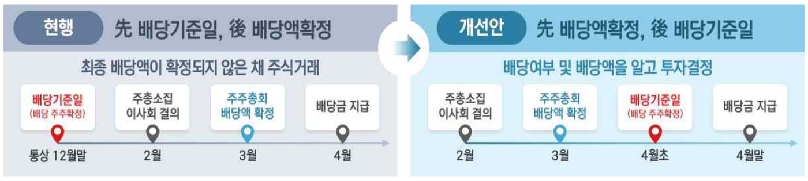

그래서 2023년 금융위원회와 법무부가 배당절차 개선방안을 내놓았습니다.
**배당액을 먼저 정해서 알리고, 배당받을 주주를 정하는 기준일은 그 뒤로** 잡을 수 있게 한 것입니다. 흔히 ‘선(先)배당액 확정, 후(後)배당기준일’이라고 부릅니다.

다만 꼭 바꿔야 하는 의무는 아니었습니다. 회사가 정관을 고쳐야 바뀌기 때문에, **회사마다 정관에 무엇이 적혀 있는지**가 중요해졌습니다.

## 2. 정관 한 줄로 갈립니다

정관의 이익배당 조항을 보면 크게 세 가지로 나뉩니다.

- **N** : “이사회 결의로 기준일을 정할 수 있다” — 바뀐 표준정관 문구입니다. (예: 기아)
- **Y** : “매 결산기말 현재 주주에게 지급한다” — 날짜가 정관에 박혀 있는 예전 방식입니다. (예: 삼성전자)
- **YorN** : 결산기말이 원칙이지만 이사회가 따로 정할 수도 있는 혼합형입니다. (예: 한화리츠)

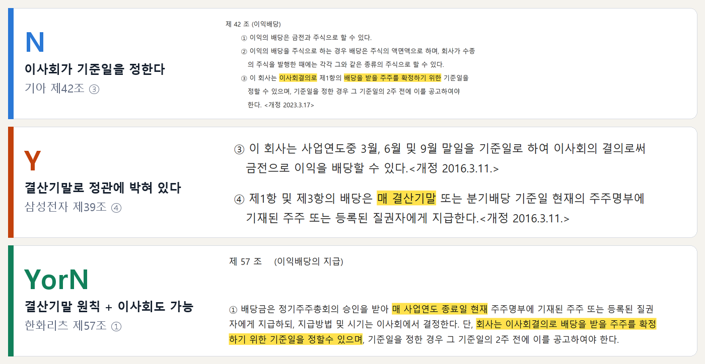

상장법인은 자기 회사의 배당기준일 조건(정관에 정한 특정일인지, 이사회가 정하는지)을 **공시부에 제출**하고, **시장운영팀**이 이를 확인합니다.
그런데 제출 내용이 부정확한 경우가 많아서, 시장운영팀이 회사 정관을 직접 열어 **한 번 더 눈으로 검증**해 왔습니다.

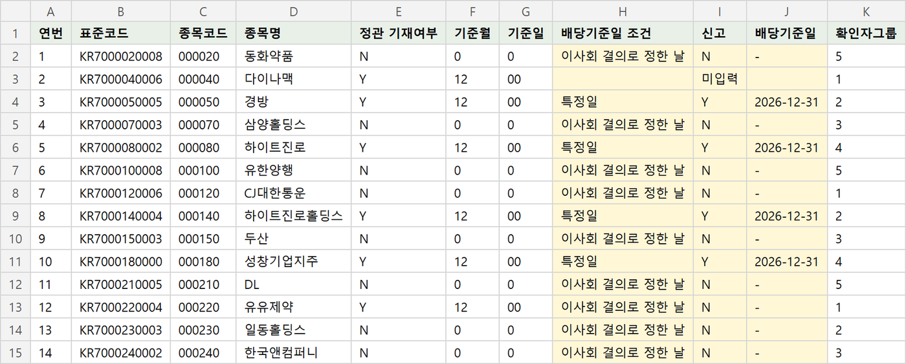

## 3. 손으로 하면 이렇게 이어집니다

회사 하나를 검증하는 데 보통 여섯 단계를 거칩니다.

1. DART에서 회사를 검색해 사업보고서를 열고, 첨부 목록 맨 끝에서 정관을 찾습니다.
2. 정관이 스캔 그림이면 검색이 되지 않아서 한 쪽씩 눈으로 읽습니다.
3. 글로 된 정관도 Ctrl+F로 찾으면 엉뚱한 조항까지 걸려서, 결국 읽고 판단해야 합니다.
4. 사업보고서가 없는 회사(신규상장, 분할 재상장, 투자회사)는 정관이 들어 있는 다른 공시부터 찾아야 합니다.
5. 정관이 그 뒤에 바뀌었는지 확인합니다. 이 단계가 생각보다 손이 많이 갑니다.
   - **왜 사업보고서 ‘앞뒤’를 다 봐야 할까요?** 정기주총 소집공고는 주총 2주 전에, 사업보고서는 주총 1주 전에 나옵니다. 그래서 사업보고서에 붙은 정관은 그 주총에서 바뀌기 **전** 판인 경우가 많습니다. 사업보고서보다 먼저 제출된 주총소집공고도, 사업보고서를 낸 뒤 제출된 주총소집공고도 모두 봐야 지금 정관을 알 수 있습니다.
   - **소집공고 열기:** DART에서 그 회사의 주주총회소집공고를 찾아 열고, 공고 안 ‘주주총회 목적사항별 기재사항’에 ‘정관의 변경’ 안건이 있는지 봅니다.
   - **배당 조항 골라내기:** 정관 변경 안건은 보통 여러 조항을 한꺼번에 고칩니다. 금호타이어는 변경 전·후 대비표가 14줄이었고, 결산배당 기준일과 관계있는 것은 그중 제42조 한 줄이었습니다. 이 한 줄을 찾아 변경 후 문구로 N·Y·YorN을 다시 판단합니다.
   - **가결 확인:** 소집공고는 ‘이렇게 바꾸겠습니다’라는 예고일 뿐입니다. 그래서 KIND에서 주주총회결과 공시를 찾아 안건 세부내역의 가결 여부를 확인하고, 가결됐을 때만 정관이 바뀐 것으로 봅니다.
6. 마지막으로 회사가 제출한 조건과 맞춰 봅니다.

이 과정을 **코스피 829사, 코스닥 1,832사**에 반복해야 했습니다.

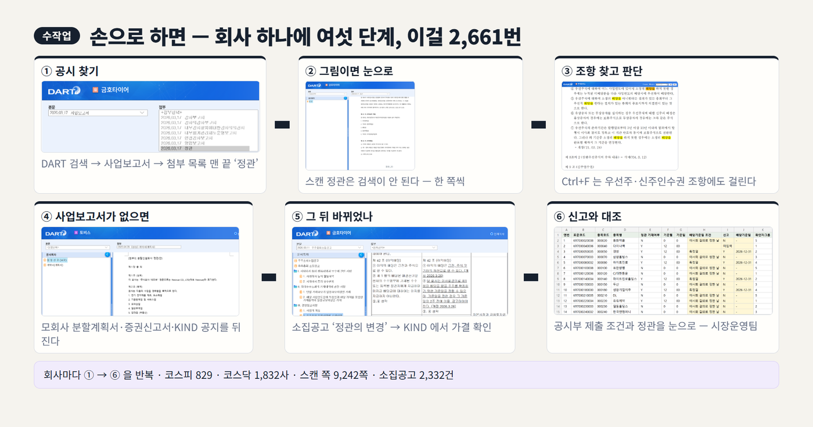

## 4. 단계마다 이렇게 바꿨습니다

### ① 정관 찾기 → 규칙 하나로

DART 화면을 하나씩 클릭하는 대신, OpenDART에서 1년치 사업보고서 목록을 받고 첨부 목록에서 제목이 ‘정관’인 것을 골라 저장하도록 했습니다.
코스피·코스닥 **2,609사의 정관을 모두** 받았습니다. DART 서버에 부담이 가지 않도록 요청 속도도 조절했습니다.

### ② 그림 정관 → Claude가 직접 읽어서 글로

스캔 그림으로 된 정관은 **Claude(생성형 AI)가 쪽 그림을 직접 읽어 글로 옮겼습니다.**
윈도우 기본 글자 인식(OCR)으로는 같은 쪽에서도 ‘지체’를 ‘지세’로 읽는 식의 오류가 있었는데, Claude가 옮긴 글은 원문 그대로였습니다. 스캔된 9,242쪽을 이렇게 옮겼습니다.

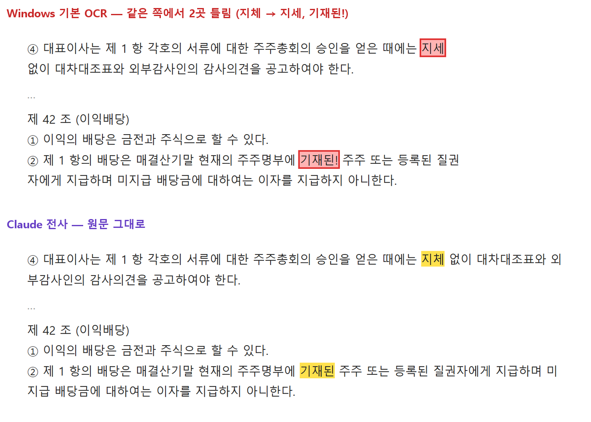

### ③ 조항 찾고 판단 → 필요한 부분만 판별하고, 엇갈린 곳은 다시 대조

Ctrl+F로 ‘배당을 받을’을 찾으면 우선주나 신주인수권 조항까지 걸립니다. 검색만으로는 어느 문장이 결산배당 기준일인지 알 수 없습니다.

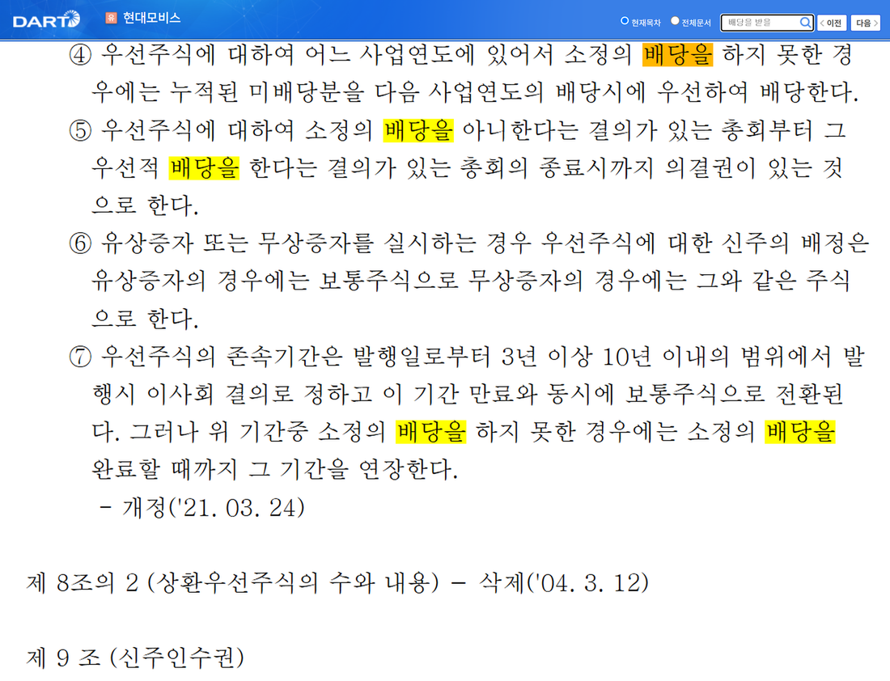

그래서 정관 전체가 아니라 **기준일 조항 근처만 추려서 Claude에게 판별**을 맡기고, 근거 조항과 근거 문장까지 함께 받았습니다.
그 답을 그대로 쓰지는 않았습니다. 근거 문장이 원문에 글자 그대로 있는지 전부 대조하고, 규칙으로 따로 판별해 맞대 본 뒤, 확신이 낮거나 엇갈린 곳은 **Claude가 정관 원문과 다시 대조해 재검토**했습니다.

예를 들어 현대모비스는 같은 번호 ⑥항이 두 개라 Claude가 처음에 YorN으로 봤는데, 재검토에서 개정 표시를 확인해 옛 문구가 지워지지 않고 남은 것으로 보고 N으로 정했습니다.

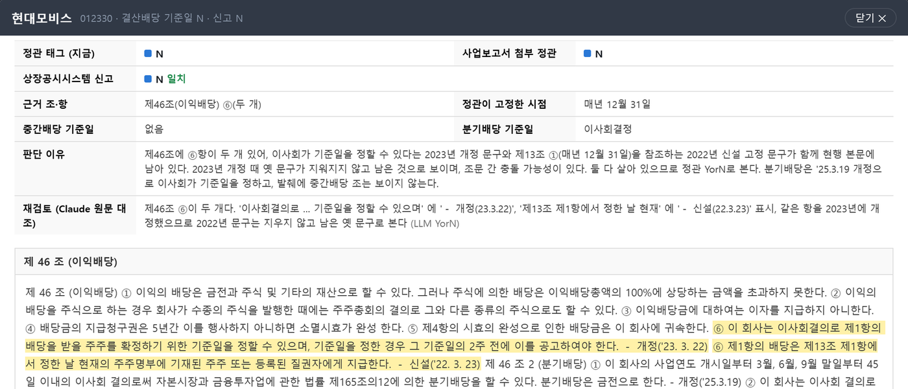

### ④ 사업보고서 없는 회사 → 상장 형태별 규칙으로

분할로 새로 상장한 네오뷰는 정관이 모회사 토비스의 분할 공시 안 ‘계약서(계획서)’ 19쪽에 들어 있습니다.
같은 공시에 붙은 ‘정관’ 첨부는 모회사 것이라, 그걸 쓰면 틀립니다.

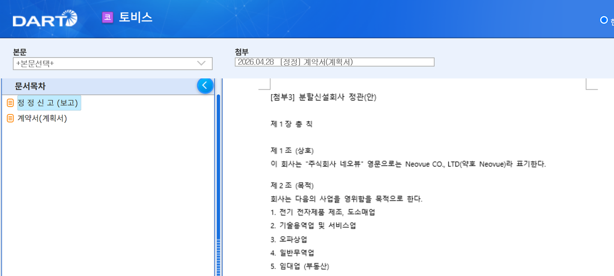

이런 경우를 **신규상장은 증권신고서, 인적분할은 모회사 분할계획서, 투자회사는 KIND 공지와 홈페이지 게시본**처럼 규칙으로 정해서 52개 회사의 정관을 찾았습니다.

### ⑤ 그 뒤 정관이 바뀌었는지 → 안건만 뽑아서, 가결된 것만 반영

정기주총 소집공고는 사업보고서보다 먼저 나오기 때문에, 사업보고서에 붙은 정관은 주총에서 바뀌기 전 판인 경우가 많습니다.
금호타이어가 그렇습니다. 첨부 정관은 Y였는데, 3월 주총에서 N으로 바꾸는 안건이 가결됐습니다.

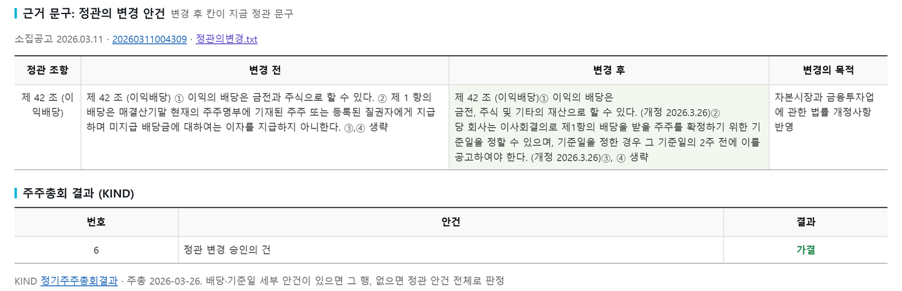

공시 원문에 붙은 ‘정관의 변경’ 안건 코드로 해당 부분만 뽑아 Claude가 ‘가결되면 어떻게 바뀌는지’를 판별하고, **KIND 주총 결과에서 가결된 것만** 반영했습니다.
이렇게 해서 사업보고서보다 먼저 제출된 소집공고의 안건으로 148사, 사업보고서를 낸 뒤 제출된 소집공고의 안건으로 25사의 태그를 지금 정관 기준으로 고쳤습니다. 부결되거나 미결된 안건은 반영하지 않았고, 주총 결과 공시에서 안건을 찾지 못한 경우는 주의 문구를 달아 두었습니다.

### ⑥ 제출 조건과 대조 → 맞지 않으면 빨간색으로

웹페이지에서 정관 태그 바로 옆에 회사가 제출한 내용을 놓고, **맞지 않으면 빨간 바탕**으로 표시했습니다. 필터 하나로 불일치만 모아 볼 수 있습니다.
코스피 829사 중 **일치 807사, 불일치 16사, 미입력 6사**였습니다.
예를 들어 프리티는 올해 주총에서 정관을 N으로 바꿨는데, 제출 내용은 Y 그대로였습니다.

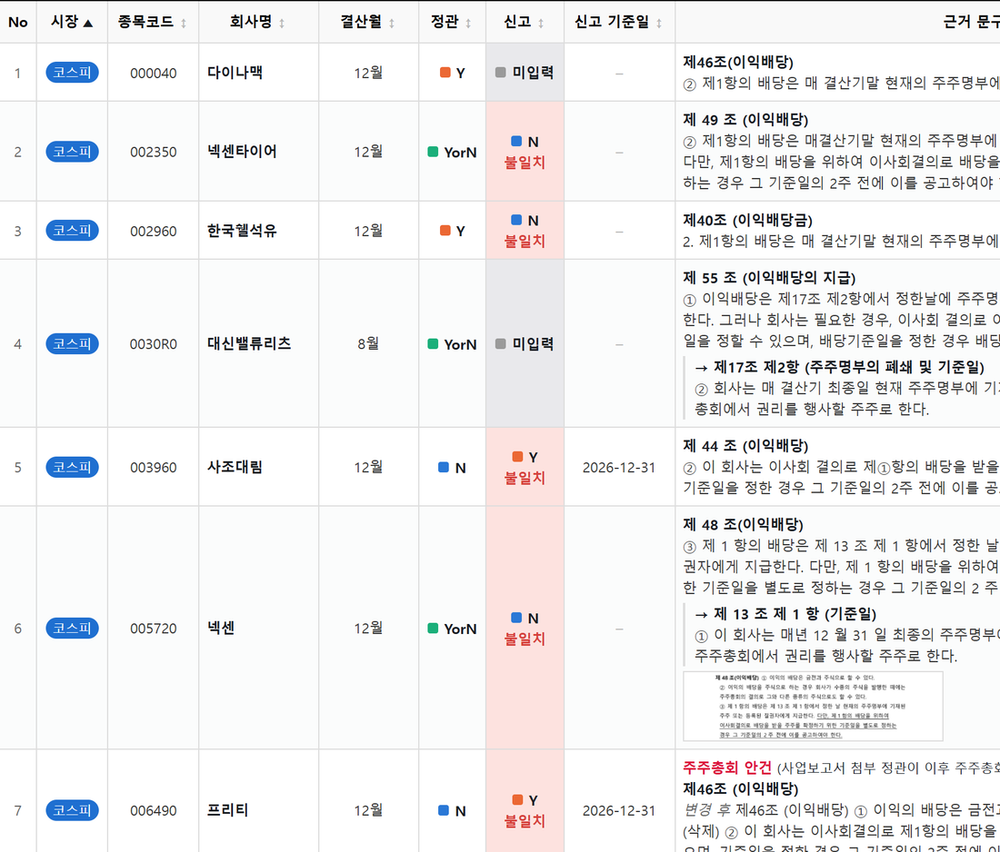

## 5. 결과

상장사 2,661곳의 정관에 N·Y·YorN을 달았고, 근거 조항과 원문 링크, 스캔 쪽 그림까지 웹페이지 한 화면에서 볼 수 있습니다.
지금 기준으로 **N 1,366사, Y 1,083사, YorN 212사**입니다.

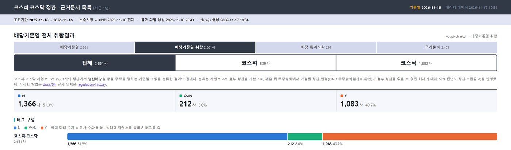

Claude는 그림 정관 읽기, 조항 판별, 주총 안건·결과 판별 세 곳에만 썼고, 결과는 근거 문장 대조와 규칙 판별로 검사한 뒤 엇갈린 곳은 원문과 다시 대조했습니다.
이제는 처음부터 끝까지 다 열어 볼 필요 없이, **불일치와 엇갈린 곳만 확인**하면 됩니다.

궁금한 점이나 따로 확인이 필요한 회사가 있으면 편하게 말씀해 주세요.
웹페이지: [웹페이지 주소]
