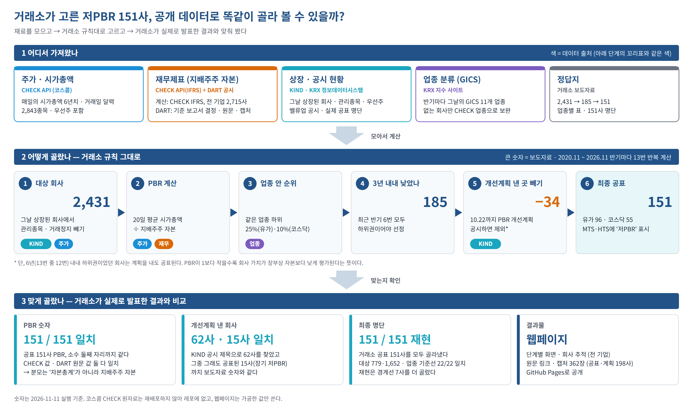

# low-pbr — 저PBR기업 최초 선정·공표(2026.11.2) 재현

> **결과 화면:** https://beaten-by-the-market.github.io/case-projects/low-pbr/site/

## 한 줄 요약

한국거래소가 2026년 11월 2일 처음 공표한 **저PBR기업 151사**를, 누구나 구할 수 있는 데이터로 거래소 규칙대로 다시 골라 봤다.
**PBR 숫자는 151사 모두 똑같이 나왔고, 거래소가 공표한 151사를 모두 다시 골라냈다.** 재현은 7사를 더 골랐다(경계선 사례).

## 한눈에 보기



그림은 위에서 아래로 세 단계로 읽는다.

### 1. 어디서 가져왔나

| 재료 | 출처 | 무엇에 썼나 |
|---|---|---|
| **주가·시가총액** | CHECK API (코스콤) | 회사 가치. 기준일 전 20거래일 평균을 낸다. 우선주 시가총액도 더한다. 거래일 달력도 CHECK 지수 자료로 만든다 |
| **재무제표 — 계산용** | CHECK API (코스콤, IFRS 재무) | 장부상 자본. 전 기업 2,715사의 '지배주주 자본' 이력으로 PBR 을 계산한다 |
| **재무제표 — 기준 보고서** | DART 전자공시 (정기보고서 목록 7.4만 건) | 회사마다 "기준일 전에 낸 마지막 사업·반기보고서"가 무엇인지 정한다. 결산월이 12월이 아닌 회사도 이것으로 맞춘다 (전 기업) |
| **재무제표 — 근거용** | DART 전자공시 (원문) | 같은 숫자를 보고서 원문에서 다시 뽑아 CHECK 값과 맞춰 보고, 원문 위치 링크와 화면 캡처를 남긴다 (KIND 공표사·계획 제출사 198사) |
| **상장·공시 현황** | KIND (거래소) | 그날 상장돼 있던 회사, 관리종목, PBR 개선계획 공시, 거래소가 실제로 공표한 명단 |
| **우선주·상장폐지 목록** | KRX 정보데이터시스템 | 우선주 시가총액을 보통주 회사에 붙이고, 그사이 상장폐지된 우선주도 챙긴다 |
| **업종 분류 (GICS)** | KRX 지수 사이트 «GICS 산업분류» | 거래소는 GICS 11개 업종 안에서 비교한다. 반기마다 그날의 업종을 받아 쓴다. 지수 사이트에 없는 회사 일부만 CHECK 업종(WICS)으로 보완하고, 최근 상장한 코스닥 회사는 업종미분류로 둔다 |
| **정답지** | 거래소 보도자료 | 단계별 숫자(2,431 → 185 → 151), 업종별 표, 151사 명단 |

### 2. 어떻게 골랐나 — 거래소 규칙 그대로

PBR은 **회사 가치(시가총액) ÷ 장부상 자본**이다. 1보다 작을수록 장부 가치보다 싸게 평가받는다는 뜻이다.
거래소는 이 값이 **같은 업종 안에서 오랫동안 바닥권**인 회사를 골랐다.

1. **대상 회사 (2,431사):** 기준일(10.22)에 상장된 회사에서 관리종목과 거래정지 회사 등을 뺀다.
2. **PBR 계산:** 20거래일 평균 시가총액(CHECK) ÷ 기준일 전 마지막 사업·반기보고서의 지배주주 자본(CHECK, DART 원문으로 확인).
3. **업종 안 순위:** 같은 시장·같은 업종에서 하위 25%(유가증권시장)·10%(코스닥) 안에 들면 그 반기에는 '저PBR'.
4. **3년 내내 낮았나 (185사):** 최근 반기 6번 모두 하위권이면 선정한다. 그래서 2020년 11월부터 반기마다 13번을 모두 계산했다.

괄호 안 숫자는 **보도자료 숫자**다. 재현 숫자는 아래 3에 있다.
5. **개선계획 낸 곳 빼기 (−34사):** 10.22까지 PBR 개선계획을 공시한 회사는 뺀다. 단, 6년(13번 중 12번) 내내 하위권이면 그래도 공표한다.
6. **최종 공표 (151사):** 유가증권시장 96, 코스닥 55. 증권사 MTS·HTS에 '저PBR' 표시가 붙는다.

### 3. 맞게 골랐나 — 거래소가 실제로 발표한 결과와 비교

| 확인한 것 | 결과 | 의미 |
|---|---|---|
| PBR 숫자 | **151/151 일치** | 소수 둘째 자리까지 같다. CHECK 재무로 계산해도, DART 원문 숫자로 계산해도 맞는다. 보도자료는 "자본총계"라고 썼지만, 실제로는 **지배주주 자본**으로 계산해야 맞는다 |
| PBR 개선계획 낸 회사 | **62사 일치** | KIND 공시 제목 "(PBR 개선 계획 제출 기업)"으로 찾았다 |
| 그래도 공표된 회사 | **15사 일치** | 6년 내내 하위권이라 계획을 내도 빠지지 못한 회사들. KIND 명단에서 찾은 15사를 재현 규칙(13번 중 12번)도 모두 장기 하위권으로 판정했다 |
| 단계별 회사 수 | 재현 / 보도자료 | 대상 **779·1,652 / 779·1,652** · 선정 117·75 / 115·70 · 제외 **19·15 / 19·15** · 공표 98·60 / 96·55 |
| 업종별 기준선 | **22/22 일치** | 시장×업종 22개의 기준 PBR이 모두 보도자료 붙임1과 같다 |
| 최종 명단 | **151/151 재현** | 거래소가 공표한 151사를 모두 골라냈다. 재현은 7사를 더 골랐는데(158사), 대부분 기준선 경계에 걸친 회사다(예: PBR 0.40 = 기준 0.40). 과거 회차에 관리종목을 빼지 못한 영향으로 본다. 회사별 내용은 결과 화면 6단계에 있다 |

### 결과 화면에서 볼 수 있는 것

- **단계 막대:** 위 1~6단계마다 보도자료 숫자와 재현 숫자를 나란히 보여 준다.
- **업종 점그림:** 업종마다 회사 PBR을 점으로 찍고 기준선을 그었다.
- **13칸 띠:** 회사마다 반기 13번 동안 저PBR이었는지를 보여 준다.
- **회사 추적:** 회사 이름을 넣으면 그 회사가 각 관문을 통과했는지 보여 준다(전 기업). 재무제표 원문 링크와 캡처는 KIND 공표사·계획 제출사 198사에 붙어 있다.

### 아직 맞추지 못한 것 (한계)

- **재현에만 있는 7사:** 기준선 경계 사례가 많다. 과거 회차에는 관리종목 지정 이력을 구하지 못해 빼지 않았고, 그만큼 과거 기준선이 조금 다를 수 있다.
- **거래정지 판정:** 거래정지 목록 대신 "20거래일 내내 가격이 안 변한 종목"으로 판정했다. 총수는 보도자료와 맞지만 회사 단위로는 1~2사가 다를 수 있다.
- **업종 보완:** KRX 지수 사이트 목록에 없는 예전 상장 코스닥사 14사는 CHECK 업종(WICS)으로 근사했다.
- **캡처 범위:** 하위 20%(약 400사)로 넓히는 작업은 아직이다. 지금은 198사의 2026.11 회차분 362장이다.

## 폴더

| 경로 | 내용 | git |
|---|---|---|
| `source/` | 보도자료 PDF(원본), CHECK 게이트웨이 노트북(키 포함 → 제외) | PDF만 |
| `docs/00-보도자료-정리.md` | 보도자료 해설·검산·모호한 점 | ✅ |
| `docs/01-재현사양.md` | 규칙(R1~R14)·가정(A1~A7)·단계·최종 대조 방법 | ✅ |
| `docs/02-데이터저장.md` | MySQL `dart_periodic` 설계, 기존 수집분 재사용 | ✅ |
| `docs/03-검증기록.md` | 날짜별로 확인한 사실 | ✅ |
| `docs/04-데이터가이드-명세.md` | 엑셀(DataGuide 6) 재현본 — 받을 아이템·옵션, 붙일 시트, 계산 규칙 | ✅ |
| `docs/img/pipeline.png` · `.svg` | 위 "한눈에 보기" 도식 (`scripts/make_pipeline_diagram.py` 로 생성) | ✅ |
| `sql/dart_periodic.sql` | 정기보고서 원문 DB 스키마 | ✅ |
| `scripts/` | 단계별 스크립트 `sNN_*.py` + 공용 `_gw.py`(게이트웨이)·`_db.py`(MySQL)·`_rules.py` | ✅ |
| `data/raw/` | 응답 캐시(CHECK·KIND·KRX) — 재수집 가능 | ❌ |
| `data/interim/` | 단계 중간 산출물. **CHECK 원천값(`mktcap_daily`·`mktcap_round`·`equity_hist`·`comp_basic`)과 GICS 종목 매핑(`gics_krx`)은 재배포하지 않아 제외** — s03·s05·s11 로 다시 만든다 | 일부 |
| `data/final/` | 정답지(`press_*`·`kind_*`)와 재현 결과(`replica_selection`·`replica_sector`). `replica_firm_round`(CHECK 원값 포함)는 제외 | 일부 |
| `site/` | 결과 웹페이지(KIND 스타일)와 DART 캡처 | ✅ |
| `logs/` | 실행 로그 | ❌ |

## 실행 순서 (다시 만들 때)

그림의 2단계는 아래 스크립트가 순서대로 처리한다. 도식은 `scripts/make_pipeline_diagram.py --png` 로 다시 그린다.

```powershell
python scripts/s00_press.py         # 보도자료 → 정답지 CSV (검산 포함)
python scripts/s01_calendar.py      # 13개 회차 공표일·기준일·20거래일 구간          [CHECK]
python scripts/s02_universe.py      # 회차별 모집단 스냅샷·종류주 매핑              [KIND·KRX]
python scripts/s03_mktcap.py        # 시가총액 (약 4시간, 캐시로 이어 받기)          [CHECK]
python scripts/s04_dart_filings.py  # 정기보고서 목록 → MySQL dart_periodic          [OpenDART]
python scripts/s05_equity.py        # 자본총계 이력·업종(WICS)                       [CHECK]
python scripts/s10_kind_valueup.py  # KIND 저PBR 목록·밸류업 공시 목록               [KIND]
python scripts/s11_gics_krx.py      # 회차별 GICS 업종 (KRX 지수 사이트)             [KRX]
python scripts/s06_select.py        # PBR·업종 컷·선정·면제 → 보도자료·KIND 대조
python scripts/s07_dart_docs.py     # 근거 보고서 원문·목차·재무상태표 값            [OpenDART·DART]
.venv/Scripts/python scripts/s08_capture.py   # 자본총계 행 캡처 (Playwright)
python scripts/s09_site.py          # 웹페이지
```

엑셀(DataGuide 6) 재현본에 붙일 시트는 따로 만든다 (`docs/04-데이터가이드-명세.md`).

```powershell
python scripts/s12_excel_gics.py      # 업종 시트: 회차 × 종목 KRX GICS (+ WICS 보완값)   → data/interim/excel_gics.csv (git 제외)
python scripts/s13_excel_filings.py   # 기준보고서 시트: 회차 × 종목 DART 기준 보고서    → data/final/excel_dart_filings.csv
python scripts/s14_excel_codes.py     # 종목 시트: DataGuide 에 넣을 보통주·우선주 코드  → data/final/excel_codes.csv
# DataGuide 에서 받은 원본(data/raw/dataguide: DG_시총·DG_자본_회계기준·DG_상태_기준일) 이 있어야 아래가 돈다
python scripts/s15_dataguide.py       # DataGuide 원본 → 계산용 CSV                        → data/interim/dg_*.csv (git 제외)
python scripts/s06_select.py --src dg # DataGuide 값으로 선정 (자본·시총·과거 12회차 관리종목·거래정지) → data/final/replica_*_dg.csv
python scripts/s16_excel_book.py      # 엑셀 통합문서: DataGuide 시트(원래 틀, A1 Refresh 가능) + 고정 시트 → data/excel/ (git 제외)
```

- CHECK 호출은 **순차로만**(게이트웨이 뒤 KOSCOM 이 IP 단위 동시 연결을 막는다). 두 CHECK 스크립트를 동시에 돌리지 않는다.
- OpenDART·DART 웹도 IP 단위로 차단한다. s04·s07 을 동시에 돌리지 않는다.
- 게이트웨이 서버 인증서가 2026-10-16 에 만료된 채 갱신되지 않았다. 루트 CA로 체인을 검증한 leaf 지문을
  `.env` 의 `CHECK_GW_FP` 에 고정해 쓴다(`scripts/_gw.py`). 서버의 Caddy 를 재시작해 인증서가 갱신되면 이 값을 비운다.

## 설정

`.env.example` 을 `.env` 로 복사해 채운다 (게이트웨이 키·CA 경로, MySQL, DART 키).
캡처용 Playwright 는 프로젝트 가상환경에만 설치했다: `python -m venv .venv` → `.venv/Scripts/pip install playwright pymysql requests pandas` → `.venv/Scripts/python -m playwright install chromium`.
